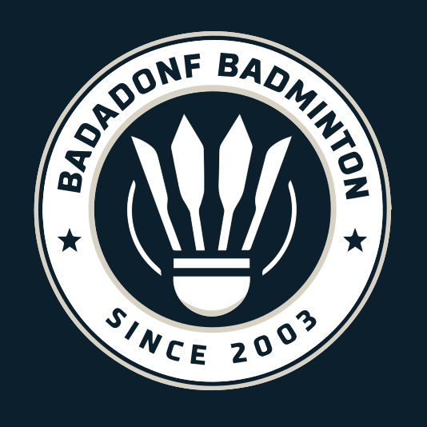

# Badadonf — tournoi de badminton à la mêlée

Une petite appli web de l'association **Badadonf** pour gérer un tournoi de badminton **en double, sans équipes fixes** : à chaque match, les paires sont tirées au sort parmi les joueurs présents, et chacun accumule ses propres résultats.

Pensée pour une table de marque en bord de terrain : un téléphone ou un ordinateur, pas de compte, pas d'Internet nécessaire.

## Ce que fait l'appli

- **Terrains, en trois étapes** :
  1. *Remplir* : l'appli propose les équipes sur les terrains libres (un terrain ou les 6 d'un coup).
  2. *Valider les équipes* : on ajuste si besoin, puis on valide terrain par terrain ou tous d'un coup. Le chrono démarre.
  3. *Valider les scores* : on saisit les scores au fil des fins de match, puis un seul bouton valide tous les scores saisis. Les terrains sans score sont laissés en cours.
- **Type de match** : *mélange libre* (sans critère) ou *mixte* (chaque équipe = une femme et un homme). Un bouton l'applique à tous les terrains, et un bouton en haut de chaque terrain le change pour ce terrain seulement. Le mixte utilise le genre renseigné dans l'onglet Joueurs.
- **Ajuster une proposition** : chaque joueur d'un terrain proposé se remplace par un joueur existant (en attente, du même terrain ou d'un autre terrain à valider) ; les deux joueurs échangent leur place.
- **Tirage équitable** : passent d'abord ceux qui ont le moins joué, puis ceux qui attendent depuis le plus longtemps. L'appli évite de reformer les mêmes paires et, si les niveaux sont renseignés, équilibre les équipes.
- **Joueurs** : ajout des retardataires en cours de tournoi, correction d'un nom, genre (pour les podiums), joueur « absent » (blessure, départ) sans perdre ses résultats, niveau facultatif.
- **Classement individuel** : pourcentage de victoires, puis écart de points moyen par match. Il reste juste même si tout le monde n'a pas joué le même nombre de matchs.
  Le tableau indique aussi le temps de jeu total et la durée moyenne des matchs de chaque joueur (de la validation des équipes à celle du score).
- **Statistiques** (bas de l'onglet Classement) :
  - le tournoi en chiffres : matchs joués, durée moyenne, temps de jeu cumulé, matchs serrés, plus gros écart ;
  - podiums général, femmes et hommes au choix : % de victoires, écart de points cumulé, plus longue série de victoires, points par match, temps de jeu. Pour les moyennes, seuls les joueurs ayant joué au moins le nombre médian de matchs sont classés ;
  - graphique en barres de tous les joueurs, du plus petit au plus grand (ou l'inverse), filtrable par genre : % de victoires, écart cumulé, points marqués, points par match, matchs joués, temps de jeu, durée moyenne.
- **Historique** : correction ou suppression d'un score saisi par erreur.
- **Mode écran** : terrains et classement en grand, pour une télé ou un vidéoprojecteur.
- **Hors ligne** : une fois ouverte, l'appli fonctionne sans réseau et peut s'installer sur l'écran d'accueil.
- **Test** : 36 joueurs fictifs et des scores simulés pour faire un tournoi blanc en deux minutes.

## Utilisation

1. Ouvrir l'appli dans Chrome (Android) ou n'importe quel navigateur récent.
2. Onglet **Joueurs** : coller la liste des inscrits, un nom par ligne, suivi si besoin du genre (`Camille, F` ou `Léo, H`).
3. Onglet **Réglages** : vérifier le nombre de terrains (6 par défaut) et les points (21).
4. Onglet **Terrains** : utiliser les trois boutons en bas d'écran, dans l'ordre : **1 Remplir les terrains**, **2 Valider les équipes**, **3 Valider les scores saisis**.

**Installer sur Android** : dans Chrome, menu ⋮ puis « Ajouter à l'écran d'accueil ».

## Données et vie privée

- Tout reste **dans le navigateur de l'appareil** (localStorage). Rien n'est envoyé sur Internet, il n'y a ni compte ni statistiques de visite.
- Les données disparaissent si l'on vide les données du navigateur ou si l'on utilise la navigation privée. Pensez à **copier la sauvegarde** de temps en temps (onglet Réglages).
- Chaque appareil a son propre tournoi : ouvrir l'appli sur un autre téléphone ne partage pas les scores.

## Mettre l'appli en ligne avec GitHub Pages

1. Dans le dépôt : **Settings › Pages**.
2. Source : « Deploy from a branch », branche `main`, dossier `/ (root)`, puis **Save**.
3. Après une minute, l'appli est en ligne à l'adresse `https://<votre-compte>.github.io/<nom-du-depot>/`.

Chaque modification envoyée sur `main` met l'appli à jour. Pensez à augmenter `VERSION` dans `sw.js` et le numéro `?v=` de `style.css` et `app.js` dans `index.html`, pour que les téléphones récupèrent la nouvelle version.

## Organisation du code

```
index.html            la page : structure et onglets
style.css             l'apparence
app.js                toute la logique (données, tirage, classement, affichage)
sw.js                 service worker : garde l'appli en mémoire pour le hors ligne
manifest.webmanifest  nom, icône et couleurs pour l'installation
logo.svg              logo de l'association
icons/                icônes de l'écran d'accueil (tirées du logo)
vendor/qrcode.js      génération du QR code (Kazuhiko Arase, licence MIT)
```

Le principe : un seul objet `S` contient les joueurs, les matchs et les réglages. Les statistiques, la file d'attente et le classement sont **recalculés** à partir des matchs à chaque affichage ; corriger un score met donc tout à jour automatiquement. Le détail est en tête de `app.js`.

Pour tester en local : ouvrir `index.html` dans un navigateur suffit (le mode hors ligne, lui, ne s'active qu'en https).

## À venir

- Variante **au temps** : tous les terrains lancés ensemble, compte à rebours commun.
- Suivi des scores en direct sur plusieurs téléphones (nécessitera une base de données en ligne).

## Licence

Le code est sous licence MIT : voir [LICENSE](LICENSE).

Le logo (`logo.svg` et les images du dossier `icons/`) appartient à l'association Badadonf. Il n'est pas couvert par la licence MIT et ne peut pas être réutilisé sans son accord.
